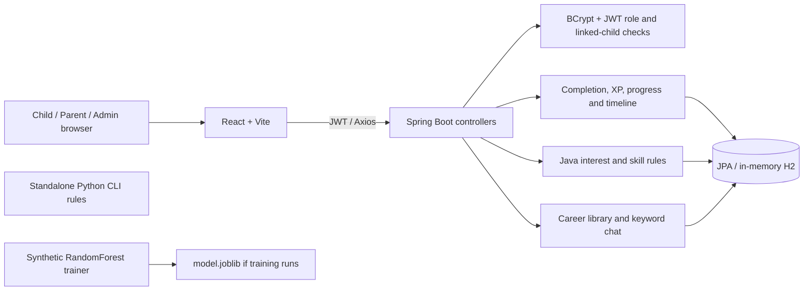

# FutureQuest AI: Stage 1 recovery audit

Audited 19 October 2026, Asia/Calcutta. Scope: the **current local working tree**, including substantial pre-existing uncommitted changes, rather than the remote GitHub HEAD. No application code, games, dependencies, configuration or existing reports were changed by this audit. No game was deleted or hidden. Stage 2 implementation requires approval, as requested in the supplied brief.

## 1. What the application currently does

FutureQuest is a working prototype for exploring activities, with a stronger presentation layer than its assessment methodology. It has **24 selectable activities, nine browsing worlds, four unlocked difficulties, four selectable age groups**, child player-code/PIN accounts and separate parent/password accounts. Eight intended domains are represented, but the stored categories are inconsistent: Communication & Language and Communication & Media coexist, alongside Creative & Lifestyle Careers and Behavioral Discovery.

Children can create an avatar, enter a world, select a game, complete its steps, save a session, receive XP and view a timeline. Parents can link a player code and inspect saved sessions, activity counts, available scores and rule-based summaries. The homepage and dashboards already have original SVG worlds, Questy, illustrated previews, responsive styling, empty/error states and reduced-motion support. This is not an untouched interface awaiting its first redesign.

### Feature inventory

| Area | Actual implementation | Limitation |
| --- | --- | --- |
| Public homepage | Explanation, hero/Questy, world showcase, activity previews, parent information, FAQ and entry actions | Preview dialogs are illustrations, not playable demos |
| Child registration/login | Nickname, avatar, age group, four-digit PIN, generated player code; local remembered profiles | Public player search and code-only parent linking create a serious privacy weakness |
| Parent registration/login | Username/email/password, BCrypt, JWT | No verified email/guardian relationship; no demonstrated login throttling |
| Navigation | React state switches between entry, role dashboards, games and career library | No URL router or saved in-progress game state; refresh loses the current activity |
| Career worlds | Nine curated world lists and game filtering | Helping has no dedicated helping engine; cross-domain placement does not itself prove domain evidence |
| Game engines | Eight core engines, eight career/discovery engines, six lifestyle engines, two preference activities | Many are short sequences of text buttons; detailed evaluation below |
| Difficulty | EASY, MODERATE, MEDIUM and HARD always selectable | Availability is implemented; meaningful progression is not universal |
| Session persistence | GameRecord, per-game/per-level progress, XP and player level | In-memory H2 clears on restart; completion and scores are supplied by the client |
| Child insights | Completed-category counts and timeline | API still returns unsupported fixed strengths after three sessions, though the current UI avoids displaying them |
| Parent insights | Linked-child authorization, actual session lists/counts, scored records, confidence/cluster labels | Formula quality and evidence thresholds are weak; feedback is not incorporated |
| Rewards | Completion stars/XP and level-derived achievement response | Achievements are not verified accomplishments; a fresh profile receives an earned badge |
| Career library | Authenticated career list, roadmap/resources, feedback | Resource completion exists only in component state; no durable completion API |
| Questy chat | Java keyword replies over authenticated API; explicit connection-error UI | No LLM or validated personalized adviser |
| Interest quiz | Ten RIASEC-inspired statements; backend submission/readback now exist | Component is not mounted by App; not a validated psychometric instrument |
| Feedback | Ratings/comments saved; child gets 10 XP | No activity ownership/existence check or duplicate-reward prevention in reviewed handler |
| Notifications | User-scoped list and mark-read endpoint | Mark-read service fetches by ID without checking ownership |
| Admin | Role-protected users, careers, roadmaps, resources, feedback and aggregate analytics | User entities expose password getters; game-rating aggregation groups all games by activity type |
| AI training/CLI | Optional synthetic RandomForest trainer; separate pure-Python prediction rules | Trainer/model are not connected to live app; schemas and labels differ |
| Testing | Java integration/HTTP tests, Python validation tests, API smoke and Edge/axe scripts | Most game/difficulty browser cases prove rendering, not complete gameplay |
| Deployment | Backend Dockerfile, frontend Vercel rewrite and configurable API origin | No durable production DB configured; Docker build skips tests; local defaults need hardening |

### Architecture and schema

There is **no observed connection** from Java to the Python CLI or saved RandomForest. No separate AI HTTP server is implemented to start.

The 17 JPA models are User, ChildProfile, ParentChildLink, ParentApproval, GameRecord, GameLevelProgress, QuizRecord, Question, Recommendation, Achievement, UserAchievement, MistakeRecord, CareerInfo, CareerRoadmap, LearningResource, Feedback and Notification. They cover identity/linking, activity, content and communication. IDs mostly express relationships as numeric fields rather than a complete object relationship graph. Entity existence does not prove a reachable workflow: ParentApproval, mistakes and stored achievements are not used to establish the current child completion experience.

GameRecord saves game/category/domain labels, score/accuracy, XP, difficulty, server date, duration, attempts, hints, replay count, completion status, choicesMade, spelling counts and story length. It does **not** retain most engine-specific fields: experiments, layouts, pairwisePreferences, curiosityPath, invention text, creative preferences, business outcomes or transcript analysis. Lists/maps in choicesMade become Java string representations rather than a versioned JSON event schema. Supplied startedAt/completedAt are not saved.

The reproducible [source inventory](stage1-evidence.json) records hashes/line counts for 102 code/config/test files, all model field declarations, controller mapping declarations and analyzer probes. These are source extractions, not runtime schema or endpoint coverage claims. Relevant implementation entry points: [catalog](../../frontend/src/data/catalog.js), [core engines](../../frontend/src/components/Games.jsx), [career engines](../../frontend/src/components/CareerDiscoveryGames.jsx), [lifestyle engines](../../frontend/src/components/CreativeLifestyleGames.jsx), [preference engines](../../frontend/src/components/InterestDiscoveryGames.jsx), [child API](../../backend/src/main/java/com/careerquest/backend/controller/ChildController.java), [parent API](../../backend/src/main/java/com/careerquest/backend/controller/ParentController.java).

## 2. What is wrong

These findings are confirmed in current source unless explicitly labeled executed. They are not claims of newly executed browser failures.

### Highest priority: trustworthy records and access

1. **Public discovery plus code-only linking:** `/api/auth/players` permits an empty search and returns player codes, nicknames, age groups and profile IDs. Any registered parent knowing a code can create a link. Existing linked-child access checks do not prevent an unauthorized person from establishing that link. Public code enumeration and the linking model must be addressed together.
2. **Records do not survive a restart.** Default H2 URL is `jdbc:h2:mem:careerquestdb`. JWT/localStorage can outlive the underlying account records.
3. **Completion is not verified.** A valid game ID and bounded client score are accepted without a server-issued session, answer verification or idempotency key. The handler unconditionally marks completion and awards XP. Transactionality and range checks are useful existing improvements, but they do not establish gameplay evidence authenticity.
4. **Sensitive serialization/configuration:** raw User getters include password hashes; child profile getters include PIN hash. Review DTO boundaries before exposing entities. The H2 console is public and permits other hosts, JWT secret is in source, CORS accepts all origins with credentials, and no application-level throttling was found. These are deployment blockers, not proof that an external deployment was penetrated.
5. Notification mark-read lacks recipient checks. Feedback lacks activity ownership/existence checks and can repeatedly award XP; feedback XP does not recalculate player level in that handler.

### Game/content fidelity

6. Photo, fashion, directing and cooking share `ChoiceFlow`; most choices do not change a visible artifact. Science, app design, leadership and career roles use closely related `ChoiceStep` interactions. Titles promise more than the mechanics deliver.
7. Mini Entrepreneur always submits **700 revenue, 20 customers, 200 profit**, regardless of ingredient/price/poster choices. The screen says each decision changes the stand, but no economic simulation computes those changes.
8. Science Lab changes its topic by difficulty (surface, soil, magnets, shadows) while retaining wood/metal/fabric and car-travel choices. There is no calculated experiment or observed result. Topic and controls can disagree.
9. Build the City finishes after three/five placements, all at unit cost. Its resource limit is always higher than the required placements. There is no connectivity, services, budget pressure or editing. Interior Designer shares this place-on-empty-grid mechanic and does not enforce its advertised hard budget.
10. Music Maker appends beat labels and finishes after three/four/five clicks. No sound synthesis/playback is present. Its `rhythmAccuracy` counts non-rest beats, which is not a justified musical accuracy measure; that field is currently discarded by the backend.
11. Eco Rescue, Dream Designer, Mini Entrepreneur, Career Role, Data Detective, Money Manager and preference activities use essentially the same content across difficulties. Other engines change only the first prompt or quantity.
12. Puzzle Laboratory creates 20 IDs but only **eight distinct prompt/options combinations**: one alternating shape pattern, one odd-one-out, five numeric series and one arrow item. Difficulty does not alter the bank. The mirror item lacks a shown source arrow. Number ordering also makes several answers predictable.
13. History is not reliable anti-repetition: most engines write history without using it to choose new content. Core puzzle/spelling select from `index + currentHistory.length`, but each answer increments both, so the selection advances by two before the 30-item cap. Fresh puzzle sessions can skip entire task types. Robot records history but never consults it; only two goal variants exist per difficulty.
14. Most engines ignore age. The global age selector offers 8–10, 11–13, 14–16 and 17+, but only core spelling/robot offsets use it, and those offsets are not an age-appropriate content model.
15. Backend question data is a separate, unused-by-live-games bank. Thirteen seeded game IDs get identical generic `Option A (Correct)` placeholders. Returning seeded rows is not proof of a validated challenge bank. HARD API metadata targets seven; core frontend uses six.
16. Data Detective assigns correctness to vague prompts such as which product “needs more investigation,” without a specified criterion. Its four charts are unchanged by difficulty. This needs content review, not simply more records.
17. Curiosity Trail lets a child click “I explored it” without launching or completing the suggested game; one suggestion names unavailable News Reporter. Interest Battle's tiny missions are text choices, not the displayed activities.

### Evidence/analysis quality

18. Child analysis returns the same vocabulary, logical-thinking and observation strengths after any three games. These are unsupported API claims even though the current child page uses cautious prose instead.
19. Parent interest starts at 10 and adds `25 × cumulative replayCount` per stored record, capped at 100. Three completions of one game can add 25 + 50 + 75, rapidly saturating evidence. Domains with many games or multi-domain tags gain more exposure; no normalization corrects this.
20. Skill starts at 50, then computes `(previous + score) / 2` per record. Scores 100 then 0 yield 37.5; 0 then 100 yield 62.5. This is order-dependent smoothing, not an average, age adjustment or improvement analysis. Repository ordering is not an assessment policy.
21. Preferred/highest difficulty is overwritten by each iterated record. HARD followed by EASY can report EASY as highest. Three sessions can trigger “Strong Evidence” and “Consistent Interest” even within one sitting. Recent/older comparisons use different time windows and do not establish a trend.
22. Enjoyment feedback is saved for lifestyle/preference completions but neither child analysis, parent analysis nor RecommendationService reads FeedbackRepository. Pairwise chosen domains and curiosity paths are discarded; all declared domains can receive credit regardless of which option the child selected.
23. Child, parent and recommendation rules disagree about domain attribution. RecommendationService fails to fall back for an empty-string careerDomains value, a common core-game record. The service has no observed live invocation outside tests; do not describe its existence as integrated recommendations.
24. Achievement response derives earned badges from player level rather than activity-specific evidence. Generic rewards cannot justify statements that the child enjoys technology or creativity.

Previously fixed issues are **not** reported here as current failures: public ADMIN signup, absent quiz routes, unvalidated score ranges, malformed-chat handling, analyzer missing-input success, false save-success UI and missing lint tooling have corrective code in the working tree. Historical reports record their earlier failures and later passes.

## 3. Game-by-game evaluation

All 24 games are routed in the frontend and allowed by backend completion validation. “Implemented” below means reachable engine code, not full playthrough verification. KEEP means retain the mechanic as a foundation, not certify it complete.

Common scoring: only Puzzle Laboratory and Data Detective currently send accuracy that becomes a score. Other live engines normally save null score and earn one participation star/40 XP. Puzzle/data stars are 3 for ≥90, 2 for ≥60, otherwise 1, each worth 40 XP. Completion evidence is client-reported.

Common interest signal **I0**: saved completion/category, difficulty and cumulative replay count; selection is inferred from completion rather than recorded as a voluntary-selection event. Local history is not longitudinal server evidence. **I+** means enjoyment feedback is additionally saved but currently unused by analysis. **S0** means no measured skill score reaches analysis. Quantities count actual content, not combinatorial click permutations as separate challenges. All ages share content unless noted.

| Game / intended domain | Actual gameplay and content variety | Difficulty / age support | Current scoring, interest and skill signals | Classification |
| --- | --- | --- | --- | --- |
| Code the Robot / technology | Program four-direction commands and animate a grid route. Four base layouts, two goal variants each; repeated within five/six rounds | Grid 4→6 and obstacles increase; age only toggles goal parity | Null score; I0; S0. Last route commands/retries sent but discarded | **KEEP** mechanic; improve generation, feedback, resets and telemetry |
| Puzzle Laboratory / technology | Three-option patterns/classification/series; 20 IDs, eight distinct combinations | Same bank all levels; five/six rounds; no age adaptation | Accuracy score; I0; task accuracy is limited skill evidence | **REDESIGN** validated visual puzzle families |
| Spell Quest / communication | Hear/type spelling; 20 words per level, 80 entries total | Longer vocabulary across four banks; age offset only | Null score despite saved wordsCorrect/Attempted; only final word attempts/hints survive; I0; limited spelling counts | **IMPROVE** session totals, non-repeating selection and accessible audio fallback |
| Speak & Shine / communication | Speak through browser recognition or type three responses; three prompts per level, 12 total | Prompt reasoning grows; no age tailoring; same three every replay | Null score; I0; transcript analysis sent only for final response and discarded; S0 | **IMPROVE** retain voice/type, expand prompts and remove unsupported relevance claims |
| Story Builder / creativity/media | Type stories from emoji scenes; five sequences/level, only first three used in each session | Sequence length increases; hard completeness flag uses word threshold; ages shared | Null score; I0; final story length saved, text/completeness not retained; S0 | **IMPROVE** editable scenes, dialogue and alternative endings |
| Dream Designer / creativity | Four selections: color, useful space, pattern, lighting; one fixed brief, three options/stage | Identical four choices at every level/age | Null score; choicesMade saved; I0; S0 | **MERGE** into a visual Interior Designer after approval |
| Eco Rescue / nature | Four fixed environmental multiple-choice questions | Identical every level/age | Null score; choicesMade saved; decisionsCorrect discarded; I0; S0 | **REDESIGN** sorting/resource consequence missions |
| Mini Entrepreneur / business | Four text choices; fixed financial result | Identical every level/age | Null score; choices saved; fake financial constants discarded; I0; S0 | **REDESIGN** actual pricing/inventory simulation |
| Career Role Challenge / cross-domain | Four fixed role-choice screens plus favorite selection | Same five stages at every level/age | Null score; choicesMade saved; favorite discarded; I0; S0 | **MERGE** with Interest Battle into an optional discovery flow |
| Build the City / engineering/helping | Place named buildings on empty grid; one unconstrained brief | Three/five placements; hard 5×5 vs 4×4; resources never bind; ages shared | Null score; layout/resources discarded; I0; S0 | **REDESIGN** connectivity, services, editable plan and binding budget |
| Science Lab / science | Four choice stages, no running experiment; four topic labels | Only topic changes; controls conflict with higher-level topics; ages shared | Null score; predictions/reasoning discarded; I0; S0 | **REDESIGN** controlled variable, prediction and calculated observation |
| Data Detective / technology/science | Four static three-bar charts with options | Same charts all levels; history offset cycles full set; ages shared | Accuracy score; I0; ambiguous answer keys limit validity | **IMPROVE** explicit questions, varied datasets and complex comparisons |
| Design an App / creativity/technology | Four fixed choices about colors, features, navigation and revision; four brief labels | First prompt changes, options do not; ages shared | Null score; features/revisions/flow discarded; I0; S0 | **REDESIGN** editable screens, linked navigation and user tests |
| Invent Something / engineering | One text idea followed by one improvement choice; four problem briefs | Problem changes by level; no enforced complexity/age model | Null score; invention/iteration discarded; word count named originalitySignal is not originality; I0; S0 | **IMPROVE** retain idea/prototype and compare revisions |
| Team Leader Challenge / business/helping | Four option stages; four scenario labels reused for all stages at selected level | Label changes, options stay fixed; ages shared | Null score; choices saved, empathy/delegation fields discarded; I0; S0 | **REDESIGN** people/task assignment and visible consequences |
| Money Manager / business | Four allocation sliders totaling 1,000, then two text decisions | One budget and two events all levels/ages; events never modify budget | Null score; allocations/adaptations discarded; I0; S0 | **IMPROVE** apply expenses, revise plan and compare trade-offs |
| Interest Battle / cross-domain | Four fixed pair comparisons, each followed by generic text mini-choice | Identical all levels/ages; social helping absent from pairs | Null score; choicesMade retains selected domains as a string; pairwise field discarded; all tagged domains credited; I+; S0 | **IMPROVE** optional neutral preference instrument, not a skill game |
| Curiosity Trail / cross-domain | Six paths, then self-reported exploration click | Identical all levels/ages; no actual game launch | Null score; repeated path in choicesMade; I+; S0 | **MERGE** into map/recommendation navigation with actual launch events |
| Photo Mission / creativity/media | Four text choices about framing, subject, angle and light; four brief labels | Initial brief changes; same options all levels/ages | Null score; composition/preference discarded; I+; S0 | **REDESIGN** interactive framing and visual story artifact |
| Fashion Studio / creativity/media | Four text choices for colors, garment category, detail and practical piece; four briefs | Initial brief changes; same options all levels/ages | Null score; revisions/themeConsistency just count choices and are discarded; I+; S0 | **REDESIGN** garment/color/pattern canvas with constraints |
| Director's Cut / creativity/media | Four text choices; no editable sequence or rendered film; four briefs | First prompt changes; same options all levels/ages | Null score; narrative/sequencing discarded; I+; S0 | **IMPROVE** real shot ordering and sound/camera preview |
| Music Maker / creativity/media | Choose one of four instrument labels, append Kick/Clap/Rest/Bell; no audio | Three/four/five beats; medium=hard; ages shared | Null score; non-rest count mislabeled rhythmAccuracy discarded; I+; S0 | **REDESIGN** audible editable sequencer |
| Junior Chef / creativity/business | Four text-choice stages; four brief labels; no actual step reordering or costing | First brief changes, fixed options; hard time/budget not enforced; ages shared | Null score; ingredient/sequence/planning discarded; I+; S0 | **HIDE** from future primary collection pending approval; retain source |
| Interior Designer / creativity/engineering | Place room-item labels in grid; four brief labels | Three/four/five placements; hard larger grid, no budget enforcement; ages shared | Null score; layout/revisions/spatial choices discarded; I+; S0 | **IMPROVE** merge Dream Designer, enable move/remove, access and cost constraints |

Legacy material is not an additional implemented live collection. The backend seeds older IDs such as Listen & Spell, Math Treasure Hunt, Cyber Detective, Space Scientist, Archaeologist, Wildlife Photographer, Emergency Doctor, News Reporter, Read Aloud, Describe the Picture, Sentence Builder and Rapid Word Challenge. Their bank rows do not constitute reachable frontend games; some are generic placeholders. Proposed status: **HIDE from product claims**, retain source/data until approved reconciliation. README's “20 games / seven domains” is stale relative to the 24-game catalog.

## 4. Recommended final collection

Target **18 distinct games**, plus optional discovery/navigation tools. This is a proposal, not an implemented catalog change. Cross-domain games have one primary reporting domain; secondary domains require evidence from specific actions.

| Primary domain | Recommended games | Distinct interaction to deliver |
| --- | --- | --- |
| Technology & logic | Code the Robot; Puzzle Laboratory; Data Detective | Command execution; manipulable logic puzzles; chart investigation |
| Engineering & making | Build the City; Invent Something | Spatial network planning; prototype/test/revise |
| Science & research | Science Lab; Space Investigator | Controlled experiment; observation-driven space investigation (new focused engine replacing legacy trivia, later scope) |
| Creativity & design | Fashion Studio; Interior Designer; Music Maker | Outfit canvas; room planning; audible rhythm sequencer |
| Communication & media | Story Builder; Speak & Shine; Photo Mission | Story scene editing; spoken/typed explanation; visual framing |
| Helping people | Team Leader; Helping Mission | Team allocation with empathetic consequences; helping scenario simulation (redesign legacy Emergency Doctor concept with reviewed content) |
| Business & leadership | Mini Entrepreneur; Money Manager | Inventory/pricing/customer simulation; changing budget plan |
| Nature & environment | Eco Rescue | Sorting and ecosystem/resource consequences with varied mission families |

Keep Spell Quest as an optional language practice activity rather than a headline career game. Fold directing choices into Story Builder's storyboard mode initially. Merge Dream Designer into Interior Designer, Career Role into optional Interest Battle, and Curiosity Trail into map navigation. Retain Junior Chef source outside the proposed primary collection. Two proposed engines fill science/helping gaps; do not build them before completing the reliable existing core. Eighteen is a scope ceiling, not a reason to delay a demonstrable, smaller milestone.

## 5. AI analysis assessment

The current system can summarize **activity exposure**, but does not yet establish a defensible assessment of emerging interests or developing skills. The product should describe transparent exploration rules until validation supports stronger claims.

`predict.py` is deterministic keyword/threshold logic. It receives free-text interests and vocabulary/logic/listening/science scores. It checks communication, technology, creativity and science in that order and returns the first three matches. It mixes ≥60 skill thresholds with declared interests; it does not use replay dates, voluntary choice, enjoyment, domain diversity or age. Nature, helping, engineering and business cannot be returned by its current branches despite some declared domain constants.

`train_model.py` defines a 50-tree RandomForest trained on 500 randomly synthesized records. Labels are selected from maximum generated skill scores, with interest flags also controlling score generation; points and level derive from those same scores. There is no held-out evaluation, external outcome, calibration, fairness assessment or real child dataset. This is circular synthetic target construction, with redundant derived features, rather than evidence of generalizable interest discovery. No train/test split exists to audit for split leakage. Synthetic generation is unseeded, so `random_state=42` on the classifier alone does not make training reproducible. The model is saved if dependencies are present but never loaded by `predict.py`. Its six labels and feature columns differ from the CLI and current eight-domain vision.

### Executed synthetic CLI probes

Each profile ran twice through the actual CLI; all repeated outputs matched. This establishes repeatability for these inputs, not model validity or backend integration.

| Profile | Input summary | Actual output / assessment |
| --- | --- | --- |
| Creative-focused | art/drawing/design | Creativity & Design; plausible narrow match |
| Technology-focused | coding/robot, logic 85 | Technology & Logic; plausible narrow match |
| Science-focused | science/space, science 85 | Science & Exploration; terminology differs from live Science & Research |
| Balanced explorer | art/coding/science/story, three scores 70 | Communication, Technology, Creativity; science dropped by fixed ordering, not comparative evidence |
| High interest, developing skill | coding/robot, logic 20 | Technology & Logic; low skill does not suppress keyword interest, but output cannot explain the distinction |
| Very limited history | empty object | Empty list; appropriate abstention |
| Skill with no stated interest | logic 95 only | Technology & Logic; demonstrates skill/interest conflation |
| Nature-only interest | nature/wildlife/environment | Empty list; domain coverage failure |

### Recommended baseline, before ML

Persist a versioned event stream for voluntary starts, recommendation versus self-selection source, completed/abandoned attempts, challenge ID/version, valid task outcomes and optional enjoyment. Store age band, difficulty, server timestamps and accessibility mode as context. Never infer interest from time alone or speech characteristics.

Report interest evidence as explicit counts: voluntary selections on distinct days, return visits, variety within a domain and optional enjoyment, with exposure/opportunity denominators. Cap same-session replay contribution and allocate cross-domain evidence only to the actions that support it. Missing feedback is unknown, not dislike. A child may enjoy one activity without liking an entire domain. Use uncertainty/limited-evidence states rather than arbitrary percentages or fixed careers.

Report skill per validated task family: correct/attempted counts, hints, successful constraints, difficulty and change across comparable attempts. Preserve null for creative quality that is not measured. Do not average unlike games into a universal ability percentage. Explain each statement using the underlying sessions and distinguish “chosen often” from “performed accurately.”

Validation must include the six required profiles at the live backend level, no-history abstention, high-interest/low-skill separation, domain-exposure normalization, shuffled-record invariance, idempotent saves, tie handling, and same-day versus multi-day replay. ML should only be considered after collecting appropriate consented evidence and an independently defined outcome; compare it against the transparent baseline before claiming improvement.

## 6. UI plan

Preserve the existing SVG visual system and Questy. Its source contains hero, technology, engineering, science, creative, media, business, helping, nature, photography, fashion, music, cooking, interiors and badge illustrations. Existing asset documentation describes them as original source artwork; this audit did not perform an external licensing investigation. No new raster/image generation is necessary for Stage 1.

| Surface | Targeted work | Acceptance criterion |
| --- | --- | --- |
| Homepage | Keep hero/worlds/parent sections; replace illustrative previews with labeled captured gameplay or a real preview | Each headline activity shows its actual interaction; claims match deployed catalog and analysis |
| Child dashboard | Keep illustrated map/welcome; make Continue refer to saved unfinished progress or label it as browsing; add evidence-backed next activities | Refresh restores a resumable game where offered; suggested games have a stated reason and remain optional |
| Games | Replace shared text-choice flows with tangible artifacts and consequence feedback | Robot executes, photo frame changes, outfit renders, science produces observations, city services connect, music plays |
| Parent dashboard | Preserve professional layout and actual record counts; replace confidence/skill formula outputs; show enjoyment and evidence dates | Every claim opens the supporting records; no fabricated baseline score, generic strength or permanent career |
| Responsive/accessibility | Retest controls for redesigned mechanics, not only page shells | Keyboard/touch alternatives, visible focus, readable instructions, 320px+ layouts, reduced motion, voice-optional completion |
| Visual assets | Extend existing SVG objects only where a new interaction needs them | Consistent palette, informative labels and no unrelated decoration or unoptimized stock imagery |

## 7. Prioritized implementation roadmap

| Stage | Work after approval | Acceptance criteria |
| --- | --- | --- |
| 2: reliability and baseline execution | Start services, execute actual browser/API flows; fix linking/privacy, ownership, DTO boundaries, durable DB configuration, session validation/idempotency and auth recovery | Registration/login/linking work; unauthorized link/read/update rejected; no hash serialization; restart retains records; duplicate completion awards once; failed saves show no reward |
| 3a: game quality pilot | Robot variety/solver, real Photo Mission, Fashion Studio, Science Lab, Mini Entrepreneur and Eco Rescue | Each mechanic is visibly distinct; outcomes depend on actions; all four levels introduce defined complexity; replay does not immediately repeat seen missions |
| 3b: remaining focused collection | City, story, budgets, data, music, helping and prototype engines; approved merges/hiding | Each retained game has a content/rubric inventory, accessible controls and meaningful end-to-end playthroughs |
| 4: evidence pipeline | Server event schema, canonical eight domains, explicit selection/enjoyment, task-specific outcomes and separate summaries | No invented strengths/creative correctness; shuffled histories yield equal summaries; cross-domain/exposure/replay tests pass; low evidence abstains |
| 5: analyzer and parent validation | Run live synthetic profiles and compare explanations to records; publish limitations | Distinct profiles differ appropriately; high interest can coexist with developing skill; no unsupported ML claim; every parent insight cites evidence |
| 6: interface integration | Update existing homepage/dashboard/game experiences around tested mechanics | Real previews, optional recommendations, accurate continue flow, evidence drill-down and coherent navigation |
| 7: illustrations/polish | Extend SVG art and feedback, tune responsive controls | No layout overflow in intended viewports; keyboard/screen-reader and reduced-motion checks executed; assets documented |
| 8: full regression/viva | Browser playthrough matrix, API/security tests, persistence/restart and production configuration checks; prepare demo | PASS/FAIL/BLOCKED/NOT RUN recorded per case; no critical unresolved defect; reproducible setup and honest architecture/analysis explanation |

Content acceptance should be specific to each engine. Question banks need reviewed answer keys, unambiguous prompts and sufficient unseen content for several consecutive sessions; a target of 20 genuinely distinct items per age/difficulty family is a starting proposal, not an existing guarantee. Procedural robot/puzzle generation must include a solver and reject unsolvable instances. Creative missions need distinct constraints, editing and a visible artifact, not arbitrary correctness. Four difficulty names stay unlocked throughout.

For a viva, demonstrate one saved child journey: freely choose an activity, play a real mechanic, select enjoyment, return on a later session, inspect task evidence and explain a parent's domain suggestion. Show high enjoyment with developing skill as a valid outcome. Present the actual Java rule pipeline; show Python as an unintegrated research prototype unless a later approved stage genuinely integrates and validates it.

## 8. Testing evidence and limits

Stage 1 is inspection and reporting. Services were not started, no application records were created and no browser regression was rerun. That full application verification is Stage 2. A local port inspection returned no listeners for 5173/8080; it is not evidence of a startup defect.

| Check | This audit's status | Evidence / limit |
| --- | --- | --- |
| Python analyzer validation suite | **PASS** | `python tools/test_analyzer.py`: three methods, invalid-input subcases, exit 0 |
| Frontend configured lint | **PASS** | `npm.cmd --prefix frontend run lint`: exit 0; configuration disables unused-variable checks and does not establish runtime correctness |
| Analyzer CLI profile execution | **PASS** execution/repeatability | `python tools/stage1_audit.py`: eight inputs × two runs; exact results in stage1-evidence.json |
| Analyzer quality expectations | **FAIL** inspection/probes | Skill-only input becomes interest; nature absent; balanced input loses science by fixed truncation |
| Source/model/controller inventory | **PASS** extraction | 102 files, 17 model classes; mappings are declarations, not successful requests |
| Full browser suite in this audit | **NOT RUN** | Deferred to Stage 2; no new browser PASS claim |
| Child/parent registration, login and linking UI | **NOT RUN** | Existing code and earlier evidence reviewed |
| World/category filtering and game selection | **NOT RUN** live | Source routes reviewed |
| Easy/Moderate/Medium/Hard playthroughs for all games/ages | **NOT RUN** | Render availability does not establish solvability, variety or completion |
| Result save, interest/skill API and parent insights | **NOT RUN** live | Current formulas and persistence fields reviewed |
| Mobile, speech/audio and manual accessibility | **NOT RUN** current session | Need new interaction-level execution after changes |
| Build, Maven, dependency audit, Docker/production deployment | **NOT RUN** current session | No installation/build artifacts refreshed |
| Browser access failure | No **BLOCKED** claim | Browser suite was intentionally not attempted at Stage 1; if unavailable when attempted, record BLOCKED with actual error |

Historical evidence is separate: [BROWSER_RETEST.md](../redesign/BROWSER_RETEST.md) and [ERROR_FIX_REPORT.md](../redesign/ERROR_FIX_REPORT.md) report 138/138 Edge checks, 24 mobile/font measurements, 40/40 smoke checks, nine Java tests and ten clean automatic accessibility states from a prior run. Of the 138 browser cases, **96 are game/difficulty entry/render checks**, not complete playthroughs. Representative completed flows include Dream Designer, Science Lab, a lifestyle engine and Curiosity Trail; this does not validate their educational or simulation quality. Older [INSPECTION_REPORT.md](../INSPECTION_REPORT.md) describes earlier failures and is explicitly historical. None of these counts is presented as freshly reproduced here.

The audit recommends a focused recovery, not another wholesale rewrite: secure reliable records first, then a small set of distinct game pilots, then a shared explainable evidence pipeline. Approval is required before Stage 2 fixes, catalog changes or redesign work begin under the supplied request.
